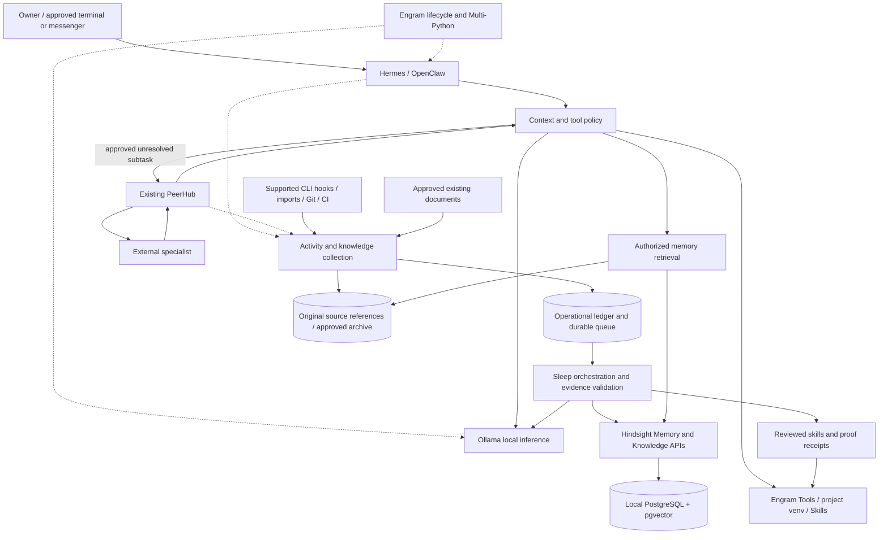

# Engram Cognitive AI Platform

## Pre-TDD Software Requirements and Detailed Architecture Specification

| Control | Value |
|---|---|
| Document | ENGRAM-AI-DESIGN-001, Rev. 0.6 |
| Date | 2026-11-28 KST |
| Baseline | Engram v3.11.13, main `61076a4734d691fe917bee562a2e2bec9c7a9148`; PeerHub v0.28.2, main `b1d877d689a9bc79d16054de7371b28b108049fd` (last inspected 2026-11-27) |
| Design ancestor | Engram_Local_AI_PreDev_Blueprint_Rev05.md, 1,284 lines, directly reopened for this revision |
| Target | Portable Windows x64, RTX 3060 12 GB VRAM, Ryzen 5 5600X, 32 GB RAM, local SSD; actual resource availability must be probed |
| Normative terms | MUST = acceptance requirement; SHOULD = default with documented exception; MAY = optional. Proposed settings are not upstream guarantees. |
| Scope | Detailed analysis and design through pre-TDD; no implementation, repository writes, deployment or actual benchmarks |

### Reading map

- Sections 1–5: product scope, responsibility boundaries, layout, runtime and lifecycle.
- Sections 6–10: local inference/context, activity capture, PeerHub, document ingestion and memory model.
- Sections 11–14: recall, verification, local-first collaboration, sleep-time consolidation and skills.
- Sections 15–20: APIs, security, failure/recovery, operations, measurements, pre-TDD release gates.
- Companion files: exact draft contracts, decisions/risks, requirement-to-test traceability, acceptance catalog, PoC/RED plan, sources.

## 1. Executive decision and scope

The platform shall be a selectively installed extension of the existing Engram development environment. It is not a new desktop OS, independent development distribution, model training project, or a replacement for existing PeerHub. It shall capture useful, authorized evidence of AI activity and personal documents, convert it into scoped knowledge and experience, retrieve only the necessary context, reuse verified procedures, and ask external specialists only when local capabilities are insufficient and authorization exists.

**One workspace; multiple compatible runtimes; one shared long-term memory service; multiple logical memory types; evidence-linked learning; one lifecycle.**

### 1.1 User-confirmed requirements

| Requirement | Direction |
|---|---|
| R01 | Existing Engram remains usable without AI or extra Python. AI root is `<ENGRAM_ROOT>/_sys/AI`; launch from Engram's terminal with `ai setup`. |
| R02 | Reuse Engram's managed Python/Node/Git/Bash/PowerShell/CLI/tools/workspace and approved existing login state; no separate full development environment. |
| R03 | Engram shall manage optional multiple CPython minor series, independently of AI; latest compatible stable patch per installed series; selectable usage. |
| R04 | Installed AI participates automatically in existing Engram update, relocate, doctor, repair, backup, restore, snapshots, tidy, reset and uninstall lifecycle. Discover and safely update installed models too. |
| R05 | Hermes and OpenClaw cooperate with existing PeerHub without Python package duplication; do not install SecondBrain; do not replace existing PeerHub DB. |
| R06 | Capture supported AI activities, including PeerHub inputs, outputs, execution states and outcomes; import accessible historical records and approved existing materials. |
| R07 | Separate evidence, knowledge, episodic experience, procedural skills, evaluation and control metadata. Share usable memory across authorized agents. |
| R08 | Add context management, hippocampal-inspired indexing/recall and idle-time memory consolidation (Sleep Engine) without competing writers or unnecessary DB services. |
| R09 | Provide English design documentation before TDD; no production implementation in this revision. |

Safety constraints inherited from Rev. 0.5: no loss of source/verified memory, no unauthorized external model calls or disclosure, no baseline Engram regression, no silent cloud fallback, no main merge/push by agents without explicit approval, minimal dependencies and no host-global modifications by default. No blanket permission to import all user files, enable all hooks, start remote bots or transmit contents externally is inferred from the feature request.

### 1.2 Success and non-goals

- Optimize verified success per external token; proposed initial 30%, target 50%, stretch 70% reduction in comparable workload, **not measured or guaranteed**. Local resource cost is also measured. Safety and correctness precede savings.
- Support Korean, English and mixed source code/error messages. Empty memory does not prevent ordinary model conversation; personal or project facts require actual evidence.
- External memory, skills and search improve future responses without changing LLM weights. No claims of biological equivalence, consciousness or continual weight training; no LoRA/fine-tuning in MVP.
- No independent Neo4j, Qdrant, Redis, Docker, WSL, alternative agent framework or SecondBrain dependency in initial install. Optional graph/OCR/STT extensions only after a justified gap and separate ADR. No dedicated scheduler service for every concern.
- No capture of private hidden chain-of-thought, unauthorized web sessions, credentials, or unavailable provider internals. Coverage is the set of explicitly enabled, actually accessible sources. No global OS keylogging or screen surveillance.
- No full-document crawler of arbitrary disks, mandatory historical import, or automatic upload of evidence. No guaranteed all-platform messenger support. No full custom RAG/Graph engine if upstream suffices.

## 2. Current facts, boundaries and ownership

The last verified Engram and PeerHub commits are pinned above; before RED work recheck the actual remote HEAD, compare changes, and rebase the design if the contracts have changed. Current code facts are supported by pinned links in SOURCES.md. Other software features are upstream documentation observations, not installed compatibility results.

| Component | Existing/selected capability | Owns | Must not own |
|---|---|---|---|
| Engram core | Managed portable tools; single default Python + venv; repair journal, lock, updater, relocation | Install identity, shared runtimes and lifecycle coordinator | LLM intelligence, memory synthesis, provider collaboration logic |
| Engram AI extension | Proposed thin orchestration | Approved config, source registry, adapter selection, ingestion/evaluation ledger, tool and memory policy, sleep scheduling | Replacement DB internals, proprietary agent clones, provider auth migration |
| Ollama | Local model serving; model tags/digests | Model files and inference protocol | Personal memory truth, access policy |
| Hermes | Agent, sessions, tools, memory providers, skill system | Native session and agent loop | Global memory authority; unauthorized cloud calls |
| OpenClaw | Agent/gateway, channels, memory plugins, Dreaming | Native session/channel state | Independent global consolidation or unrestricted remote shell |
| Hindsight | Retain, Recall, Reflect, observations, mental models, Pages, Knowledge Banks (1.3) | Memory/knowledge service and derived indexes | Verification authority, original-source ownership, arbitrary tool execution |
| PostgreSQL + pgvector | Relational storage and vectors | Hindsight's supported schemas; backed up logically | Public integration SQL bypass, PeerHub replacement |
| SQLite activity ledger | Local operational metadata (proposed) | Cursor, correlation, idempotency, evidence checks, outbox, jobs, policy references, evaluations | Duplicate full long-term memory or full source transcripts by default |
| Existing PeerHub | Peer/Stream/Record/Offset, bridge, sessions, outcomes, usage, routing | Authoritative collaboration record and execution truth | Hindsight service, Engram installer, semantic truth of task completion |
| Git/filesystem + native agent stores | Source documents, logs, commits, skills, sessions | Original evidence/approved derivatives and executable procedures | Automatic proof that every source claim is true |
| markitdown-gc | Existing optional document conversion | Local parse/converted representation | OCR verification or general memory DB |
| SecondBrain | Independent source-preserving workflow | Its existing independent data | Not installed, scanned, modified or required by this feature |

Engram existing `launcher.build_env` resolves tool paths, `.engram` configuration locations, environment variables and default venv; it creates some directories. Dispatcher resolves PATH but is not identical to full launcher. Refactor only the necessary pure environment resolver/read-only entry; preserve caller-visible behavior. Existing Python update/repair functions assume `_sys/env/python` and `_sys/env/venv`. Existing `env_ops`/`env_lock` already model crash-safe transactions. The new design wraps and generalizes rather than discards these. Core update helper recursively copies staged `_sys`; package builder and uninstaller need explicit AI subtree ownership rules. Existing personal backup uses a restricted allowlist; it does not automatically include new AI state.

PeerHub current `ask` persists a prompt Record and materializes a response Record with `reply_to` and delivery metadata; bridge state and evidence include attempts and certainty, session generation and usage where available. `peerhub outcome` is an existing feedback command. Its `extensions/memory.py` is an optional derived memory API with candidate/accepted/rejected/superseded/revoked states, not an automatic Hindsight integration. Public CLI lacks a generic incremental activity-export command at this baseline. See section 8 for exact consequences.

### 2.1 Logical architecture



Control plane: install, version/manifest, supervisor, repair, backup and update, with no implicit LLM/provider calls. Data plane: inference, retrieval, collection, verification and task execution. Policy is enforced at external boundaries, not by prompts alone. One GPU scheduler controls work admission; a separate graph DB is not necessary initially. A failure in the memory pipeline MUST NOT change already committed PeerHub delivery truth or prevent ordinary offline Engram usage.

### 2.2 Profiles and dependency graph

| Profile | Components | Activation |
|---|---|---|
| absent (default) | Existing Engram only | No AI-related download, remote check, directory creation, background process or runtime registry mutation |
| runtime | Ollama + approved model | Local direct helper, no agent dependency |
| agent | runtime + selected Hermes or OpenClaw | Native session independent; memory optional |
| memory | runtime + Hindsight + PostgreSQL/pgvector | Loopback, no agent mandatory |
| full | runtime + Hermes + OpenClaw + memory + policy/collector/sleep components | Proposed default after explicit `ai setup` confirmation; sources and sleep separately opt in |
| graph-extra / media | optional future components | Disabled by default; measured gap and approval required |

Resolve profiles as a DAG; no auto-install of components that were not selected. Existing installed partial profile participates in update; absence is not an error. Source detection does not equal enrollment. The user can install and use Multi-Python without any AI. PeerHub missing => `UNAVAILABLE` with guidance, not installation or empty DB creation. Agent-only profile can operate without Hindsight but cannot claim recall or experience ingestion. Separate process for each app, shared local inference endpoint, separate native sessions.

## 3. Physical layout, packaging and portability

```text
Engram/
  Engram.exe                        existing
  engram.cmd                        existing
  .engram/                          existing Claude/Codex/GH config; do not migrate blindly
  workspace/                        existing user work
  _sys/
    core/                           existing + shared runtime manager / lifecycle hooks
    cli/engram.cmd                  existing
    cli/ai.cmd                      thin proposed wrapper
    env/
      python/                       legacy default; unchanged physical path
      venv/                         legacy default; unchanged physical path
      python-versions/<series>/<build-id>/
      python-envs/<owner>/<env-id>/
      nodejs/ git/ pwsh/            existing
    data/state/python-registry.json
    data/setup-files/               managed runtime artifacts / cache
    tools/                          existing
    AI/
      core/                         versioned source: lifecycle, adapters, policy, jobs
      defaults/                     versioned templates, schemas, profiles and reviewed skill templates
      apps/{ollama,hermes,openclaw,hindsight}/
      runtime/{postgresql,node,vendor}/   only missing or unavoidable private runtime
      models/{ollama,huggingface}/
      config/                       relative references, policy, enrolled source settings
      data/
        agents/{hermes,openclaw}/   native sessions, private state
        postgres/                   PGDATA; active managed generation
        knowledge/                  source manifests and approved extracted text when required
        experiences/                approved receipts/exports, not a second live memory DB
        skills/                     versioned approved portable procedures
        archive/                    optional approved copies, immutable manifests
        ledger/activity.db          SQLite control plane and evidence relations
      secrets/                      references/ACLs; vendor location exceptions
      state/                        component, model, index, operation manifests and leases
      logs/ cache/ backups/          private mutable files
```

Only explicitly reviewed static `_sys/AI/core`, `_sys/AI/defaults` and the CLI wrapper are included in release packages and Git. Do not rely on blanket recursive copying or extension-based exclusions: exclude all mutable data, vendor app installs, logs, credentials, model blobs, local caches, runtime archives and backups; allowlist static file types/paths, check staging and archive contents using synthetic sentinels. Public repository fixtures must be fabricated. Python-versions/envs and runtime cache are mutable managed assets, not release files. Protect active AI subtree during detached self-update. `ai.cmd` must resolve from its physical location, not the current directory, and propagate argv and exit status. Root must have no new launcher.

Use root-relative references in persistent managed manifests; resolve to absolute paths at launch. Normalize Windows case/path identity, reject traversal, unapproved reparse points, path substitution and `_sys/ai` case-insensitive legacy collisions. Do not move original user files; allow approved link or copied archive with independent hash. Never claim an index copy replaces original evidence. No permanent PATH, registry, app alias, SUBST, junction, USERPROFILE/HOME changes. No default administrator Windows service, task scheduler or autorun. NTFS SSD is recommended; network share, syncing live database, removable drive and unsupported filesystem are not certified. Portable means move the full Engram tree while quiesced; host NVIDIA drivers, OS security and vendor sign-in may still be host-dependent. Standalone extraction of AI is out of scope.

## 4. Multi-Python and execution environment

### 4.1 Provider and registry contract

Keep existing default Python and venv paths. Additional Python *minor* series (3.13, 3.14, etc.; major = 3) are installed only on request or as approved app dependency. Each series has one selected stable compatible patch, with multiple immutable builds for rollback, exact pin and vendor exceptions. Identity = implementation + exact version + ABI + architecture + provider + distribution flavor + artifact digest. Share an interpreter only when all of these and consumer constraints match. Separate site-packages/lock per app or project. User-owned external `.venv` is not adopted silently. Python 2, EOL, prerelease, debug/free-threaded, 32-bit, non-CPython and WSL are outside MVP. Discovery must be dynamic, not fixed to a list. Record latest source version, latest trusted available Windows binary, latest compatible candidate and installed build separately. Security-only releases may be source-only; report `SOURCE_NEWER_NO_BINARY` rather than invent a binary or claim current. No automatic downgrade, cross-minor upgrade, provider/ABI switch, source compile or EOL installation.

Provider priority: preserve official embed-based legacy implementation; evaluate verified full portable CPython archive (e.g., Python Build Standalone) for extra series, as embeddable distribution does not promise ordinary pip support. Consider `uv` as resolver/cache/venv builder with explicit interpreter, verified lock and no implicit Python download. Do not adopt default `uv python upgrade` or unverified installer behavior that creates junctions, registry entries or host aliases. Pin exact supported version and flags; no vendor script from arbitrary URL. Authentic upstream checksums/signatures or trusted attestation are required for new artifacts; self-computed hash alone is not proof of authenticity. Build identity and registry schema are in CONTRACTS.md.

The current reference catalog in Rev. 0.5 had CPython 3.15.2 and Node 26.13.1. These are baseline inventory values, not mandatory versions for new apps. Verify installed reality. The 2026-11-27 support table identified 3.15/3.14 bugfix, 3.13/3.12/3.11 security and 3.10 EOL; query current official data at execution. Use Windows x64 standard-user probes for SSL, SQLite, ctypes, venv/virtualenv, pip, ABI/native DLL/wheel imports, package lock and `pip check`.

### 4.2 CLI and selection

`engram python` is a new general namespace. `list`, `where`, `doctor` are offline/read-only. `install 3.14`, multi-series install, `install --all-supported`, `check`, `update`, `use`, `run`, `pin`, `unpin`, `remove` follow CONTRACTS.md. `use` opens a child shell, not a mutation of its parent environment. `run 3.14 -- -m pytest` passes arguments verbatim and returns child status. Pin only writes an explicitly authorized project pin; never replace an existing conflicting lock or delete unowned user files. No implicit installation during `run` or directory navigation. Selection: explicit valid task/user binding → registered project pin/constraints → existing default. Fail closed on conflicting selection. Core and installed PeerHub use their own pinned executable and ignore user shell selection. App runtime is chosen independently of task environment. No silent fallback to host Python or unexpected global `pip`.

### 4.3 App versus tool execution

`base_env = Engram.resolve_env(root, read_only)`; create independent `app_env` and `task_env`, not one overlay inherited everywhere. Strip app-specific Python/Node paths and VIRTUAL_ENV/PYTHONHOME/PYTHONPATH/PYTHONUSERBASE/UV/PIP/npm overrides from tool children; apply only selected project's approved environment. Preserve essential Windows variables. Use explicit executable identity, argv, cwd and bounded output; verify PowerShell, CMD and MSYS/Git Bash quoting including Unicode and spaces. A subprocess environment is not a security sandbox. Existing `.engram` config locations may be forwarded only to the approved relevant tool process; do not pass provider tokens, bot tokens, DB passwords or raw login state to general agents. `CLAUDE_CONFIG_DIR`, `CODEX_HOME`, `GH_CONFIG_DIR`, Git config retain existing behavior; Antigravity's host profile/keyring limitations stay visible. Determine tools dynamically via existing catalog and executable probe, not a duplicated list. Tool discovery does not grant execution permission.

Hermes Windows PM currently uses a pinned Python build; a documented build-time interpreter override does not prove production launch/update compatibility. Test PM lock, supported external interpreter, lazy-install behavior, paths and all launcher/upgrade entrypoints. Preferred A: compatible common runtime + isolated app env through supported upstream contract. B: vendor-pinned private runtime inside managed AI root, recorded as exception, not shared or manually repinned. C: block Hermes profile if no safe path or required context performance. Hindsight uses a separately locked environment and verified wheel/ABI; slim plus local backend is a candidate, not guaranteed equivalent. OpenClaw reuses compatible Node, with separate npm prefix/lock; verify native add-ons. Agent internal `sys.executable` correctly points to its own Python; user project code MUST use approved typed tool environment. PeerHub subprocess uses existing installation/executable, selected existing DB, base tools and authorized account context; no import from Hermes env, pip duplication or automatic DB initialization.

### 4.4 Runtime transaction and garbage collection

Plan from registry revision and affected consumers; verify signed/pinned archive, space for old/new, dependencies and lock. Build additional interpreter/env at final unique but unpublished path (a venv may embed absolute paths; do not rename it casually). Probe, build independent consumer envs, test each consumer, quiesce affected owned processes, publish bindings atomically, recheck health, retain previous generation. Exact pins continue to reference old builds. Shared series changes do not force all consumers to switch. For default in-place swap invoke existing Engram repair/handoff with preflight, drain/rebuild dependencies and rollback; preserve existing flags and recovery runner. Journal crash seams around stage, registry CAS, service stop/start and after-commit receipt. A failed optional group may be blocked while independent groups commit; report PARTIAL. Do not claim global all-or-nothing rollback. Protect active/pinned/rollback/pending/backup/referenced or unknown external usage from GC. No force-termination of unrelated user processes. Remove only after registered references and real interpreter paths validate; default protected. Report that unmanaged venvs outside registered scope are not guaranteed.

Relocation regenerates owned venvs/console scripts from locks and cached artifacts at new root; no global string replacement. Offline cache missing => block affected component, preserve source/data, report missing wheel/hash; no host fallback. Store registry, version/lock and optional offline packs in backups. `ai uninstall` releases AI-owned consumer bindings and keeps other user Python. `engram uninstall` can remove owned program runtime but preserves data/lock export. Existing legacy archives and core commands remain compatible.

## 5. Installation, services, model updates and integrated lifecycle

### 5.1 Components and feasibility

| Component | Proposed acquisition | P0 proof required |
|---|---|---|
| Ollama | Official Windows AMD64 standalone ZIP | GPU driver, process ownership, paths, loopback, disable/deny cloud, actual API context |
| Hermes | Pinned supported Windows release/PM | Approved runtime ownership; 64,000 context, tools, native state, Hindsight integration |
| OpenClaw | Pinned npm artifact + lock | Node/ABI, gateway foreground, safe onboarding, memory plugin/auth |
| Hindsight | Pinned OSS 1.3-compatible package candidate | External managed PG, provider settings, KB support, review/consolidation APIs, model memory footprint |
| PG + pgvector | Verified compatible Windows distributions | Extension ABI/major/arch, VC runtime, non-service start, DB role/backup/restore |
| pg0 | Only isolated feasibility spike | Not production durability proof |
| Local OCR/STT | Optional existing/approved parser engine | Original/locator preservation, controlled processing and quality |
| PeerHub | Existing executable & explicit selected DB | Read-only discovery, actual CLI versions, dry-run, no external call |

No exact new package pin/hash/license yet. WP0 records artifact URL, publisher/signature or trusted digest, dependency lock, arch, license/redistribution, approved write footprint, compatibility probes, setup behavior. Download → stage → verify → canary → publish; no upstream lazy installation or automatic updater outside coordinator. No binaries or models in public distribution. No unsupported installer silently executed. A user's existing service on a port is not ours: report conflict, require explicit adopt/reference or choose another port; never kill it.

### 5.2 Environment and process supervision

Candidate runtime settings (validate against exact versions; render only to scoped children): `AI_ROOT` internal; `OLLAMA_MODELS=AI/models/ollama`, `OLLAMA_HOST=127.0.0.1:11434` or allocated port, `OLLAMA_NUM_PARALLEL=1`, `OLLAMA_MAX_LOADED_MODELS=1`, bounded queue (16 candidate); `HERMES_HOME=AI/data/agents/hermes`; OpenClaw dedicated home/state/config/workspace; Hindsight DB URL from secret reference, local LLM provider and loopback `/v1`, local embeddings/reranker with CPU-first and no remote code, HF cache rooted inside managed tree. Use provider-specific env names only after version verification. Local models first-download must be planned explicitly; Hindsight default LLM is documented as OpenAI, so explicitly override all retain/reflect/consolidation/decision providers and fallback chains. KB provider is separate; set explicit local/text strategy and prevent remote fallback. Secrets never appear in argv/logs/manifest. Host HOME/USERPROFILE not changed. Model caches and dependency caches are scoped; share downloads when supported, never mix live package paths.

Service DAG: PostgreSQL → Hindsight; Ollama → inference callers; policy tools/collector before agent integrations; sleep engine after memory/ledger ready; messaging gateways last. Launch owned foreground processes using supervisor, startup probe protocol/version/DB extension/model configuration; PID alone not readiness. Record install UUID, executable identity, PID, process creation time, generation, port, health/error. Use bounded restart/backoff (no restart storm); stop accepting work → drain/cancel at safe boundaries → persist pending queue → stop gateways/agents/workers → Hindsight → PG/Ollama. Check actual owned process before any termination. Duplicate start idempotent; stale lock recovery proves ownership. No default autorun. Unexpected process loss: surface `DEGRADED` and restart only under explicit enabled policy; unknown data truth remains unknown.

### 5.3 Model catalog and safe update

Maintain immutable role/revision metadata: backend, upstream id, tag, resolved digest, size/quantization, context and capabilities, license, time of check, active/previous generation, pin, consumers, evidence and index fingerprint. Roles: primary LLM, lightweight routing/extraction, memory LLM, encoder, reranker, optional OCR/STT/vision. Models may be shared if actual interface/digest/space match. Discover only managed installed roles, compare official registry metadata vs local inventory (Ollama `/api/tags`); `latest` mutable tag is not identity. `--check`/`--dry-run` fetch metadata if allowed, no blob pull, model load or write; offline use cache only with age and unknown/stale status. Source unverified or inaccessible => NOT_CHECKED, not current. Recommend better family/size as candidate; approval required for different family, quant, license, capabilities, major migration or remote endpoint. Do not auto-download all new models. Custom GGUF/Modelfile is user-owned; inventory not overwrite.

Same approved model variant update: stage using pinned backend supported copy/ref/isolated candidate without losing old manifest/blobs; verify digest and size; test Korean/English, JSON, tool use, contexts, task/evidence accuracy, TTFT/TPS, GPU peak/OOM, absence of provider egress; drain affected owned service, publish new role pointer and invalidate dependent context cache; rollback old generation on failure. Existing session does not silently switch model. If no safe staging/rollback contract, block auto activation. GC via vendor-supported process; keep active/previous/pins/shared blobs/recovery refs. Budget initial disk 60–100 GB for runtime, models, staging/rollback; actual need computed from catalog, source volume and backups separately.

Encoder revision/tokenizer/prefix/dimension/normalization/space changes, even at equal dimensions, require isolated index generation. Separate memory encoder and KB multimodal/text encoder identities. Pinned Hindsight 1.2+ documents reembed and bank exports; 1.3 KB paths require separate verification. Prefer write drain, consistent DB and file/attachment/ledger backup, independent candidate DB/schema or supported shadow migration, regenerate all affected embeddings, compare document/fact IDs/source relationships/ACLs/attachments/observations/mental models/Pages plus recall gold, atomically switch compatible endpoint/encoder/index, keep old generation. Follow exact upstream reembed/finish workflow only after candidate drill; no old/new vector mixing or unsupported direct SQL. KB generation migration may require documented rebuild, not assume memory reembed covers KB. If no replayable source, insufficient disk, partial migration or unsafe rollback => hold old model. Explicit risk approval required; `-y` alone cannot authorize destructive migration or data deletion.

### 5.4 Unified lifecycle behavior

| Command | Installed AI / extra runtimes behavior |
|---|---|
| `ai setup` | Proposed full profile, preflight and explicit confirmation; smaller selection, idempotent repair of selected missing items, no surprise app enrollment/import; noninteractive `--apply --yes` |
| `engram update` / `-y` | Existing core/tools policy + safe compatible patches of installed extra Python + installed AI programs, plugins, dependencies and model updates. Legacy default Python retains its own `--only python` policy. |
| `engram update --check/--dry-run/--refresh` | Complete applicable plan/metadata discovery, no service stop or blob download; preserve current cache/check semantics, distinguish unknown. |
| `engram update --only ...` | Exact scopes, affected dependency safety checks only; no unrelated update. Proposed `ai`, `models`, `python-versions` selectors must pass legacy parser tests. |
| `engram python update` | All selected installed series including default through legacy adapter, no unrelated models/apps. |
| `engram doctor` | Offline/read-only diagnostics for optional systems; no inference, provider, metadata fetching, queue writes or automatic migrations. Stopped can be healthy. |
| `engram relocate --apply`, `repair --apply` | Existing preview/apply rules; path/venv/config/DB references, model store and cursor/skill artifacts; exact repair, not implicit latest upgrade. Offline rules. |
| `--resume/--rollback` | Existing journal identity plus child receipts; verify actual state, resume once, no duplicate effects. |
| `engram backup/restore`, `snapshots list/restore` | Coordinated durable data, inventory and verified cross-store checkpoint. Legacy archive without AI leaves AI untouched. Data-only restore on absent target does not run services or download. |
| `engram tidy --apply` | Safe expired cache/stage/log cleanup and reference-aware GC; never erase originals, verified memories or active/pinned generations. |
| `engram reset --apply` | Explicit AI scope, separate typed confirmation, verified backup; no automatic permanent-data purge. |
| `engram uninstall` / `ai uninstall` | Stop owned services, remove owned program assets; preserve models, memories, skills, secrets, backups by default. AI-only does not remove shared tools/Python/PeerHub. |

Detection states: ABSENT (static source alone), INSTALLED, PARTIAL, UNKNOWN, CORRUPT, LEGACY_COLLISION. Unknown/collision => diagnostic and safe recovery, never guess deletion or install. No new downloads/writes for absent. One coordinator for `ai` commands and existing Engram lifecycle; optional module imports only after marker detection, static wrapper available before setup. Existing CLI help/flags/exit semantics preserved, new JSON versioned/additive; where legacy command does not support JSON, extend only after regression fixtures, not silently change it.

Parent operation carries install/root ID, operation/plan/approval digest, target scope, dependency groups, current/target generations, service pre-state, child receipts. Lock order: global Engram lifecycle → registry state → AI service group → short ledger transaction; never acquire earlier lock while holding later. No DB transaction spans network/inference; no GPU lease while waiting on dependent jobs. Detached core updater persists plan and service state, reopens current coordinator and revalidates approval/version after handoff, resumes only verified phase. In-progress journal blocks conflicting mutations, recovery/read-only permitted. Related runtime/app/DB/encoder dependency group commits only coherent state. Core success with AI failure => PARTIAL, not success; old version recoverable or RECOVERY_REQUIRED. Only previously running services restart; no newly enabled bot, external call, or unsolicited scheduled updater. Backup, restore and relocation pause sleep/collection writers and resume only permitted policy and prior service state.

## 6. Local inference, context and resource scheduling

### 6.1 Context is a working-memory limit, not persistent memory capacity

A model has a trained/declared positional/context limit. A server has an allocated effective limit, a model/backend capability contract, and a memory/time constraint. An agent has a further working budget after system prompts, tools, current task, retrieved evidence, tool output, history, reasoning/output reservation and safety margin. Define `C_effective = min(declared_supported, verified_backend_allocation, tested_profile_limit)`; if any indispensable limit is unknown, mark profile unverified rather than assume infinity. For Hermes the documented minimum is 64,000 tokens. An advertised model maximum or Ollama `/api/show` alone does not prove allocated length; verify actual runtime using backend telemetry, `ollama ps` where supported, and end-to-end long-input/tool tests. Set context server-side or per managed model definition for OpenAI-compatible Ollama calls; do not assume `/v1/chat/completions` can change it. Never fake Hermes context metadata or lower its safety check. The current Ollama defaults depend on available VRAM; explicitly set and verify the managed allocation rather than rely on defaults.

The resource estimate for an ordinary full-attention decoder with grouped-query attention is approximately:

`KV_bytes = 2 × attention_layers × kv_heads × head_dim × allocated_tokens × concurrent_sequences × bytes_per_element`

This excludes block metadata, alignment, activations, graph buffers, weights, recurrent state, multimodal encoders and OS/display reservations. Sliding-window, hybrid/linear attention and architecture-specific caches need actual per-layer accounting; never apply all layers to a hybrid model or use a blanket percentage as measured VRAM. A 12 GiB card does not guarantee 12 GiB available. Quantizing weights and KV cache are distinct choices. Q8/Q4 cache nominal element sizes reduce memory versus FP16 but block overhead and quality vary. Offload to system RAM may avoid OOM but increase latency substantially; pagefile is not a performance plan. Long prompt prefill, decode speed, memory bandwidth and tool-call reliability matter more than context advertised by marketing. The model's maximum context is not evidence of usable accuracy at that length.

| Workload | Candidate model/profile | Initial context goal |
|---|---|---|
| Exact lookup, hashing, parsing, diff | CPU deterministic tools | No LLM |
| Classification, route, simple extraction | Qwen3.5 small/4B candidate or measured equivalent | 4–8K direct API |
| Document extraction, ordinary local reasoning | 4B/9B candidates | 8–32K direct API |
| Hermes interactive agent | 4B/9B candidates, Q8 cache first if supported | at least 64,000, typically 65,536 configured/tested |
| OpenClaw | compatible local candidate | test 16/32/64K |
| Large tasks | approved segmented processing or larger validated allocation | 128K/256K experimental only |
| Memory embedding | multilingual BGE-M3/Qwen3-Embedding 0.6B candidate, CPU-first | independent encoder limit |
| Rerank / OCR / STT / KB multimodal | selected local backend, CPU-first where viable | independent limits |

Qwen3.5 model families are candidates only; published 4B/9B downloads are not their runtime footprints and 256K declared capability does not certify this GPU. Reject unsupported tool/JSON/context profiles. If Hermes cannot pass 64K with acceptable quality/latency, keep it unavailable; direct small Ollama helper and/or validated OpenClaw can still operate, or owner can separately authorize external assistance. No silent cloud fallback. Model selection includes exact digest, quantization, model template/tokenizer, embedding/rerank settings, GPU allocation, test dataset and result. For memory extraction use small schema-conforming model first, more capable local model only if needed. Never send restricted material to remote embeddings, OCR, summary or decision fallback.

### 6.2 Context Manager design (CM)

CM is a policy/admission and context-pack coordinator, not a second Hermes context implementation. Reuse native conversation/session compaction where the pinned agent can preserve invariants; otherwise inject a bounded structured packet through supported tool/plugin interfaces. Disable duplicate automatic recall or account for its worst-case budget. No unsupported patch of vendor internals. Agent internal token count may differ from external provider count: tokenizer-specific exact count where available; conservative estimate with measurement status otherwise. Never claim a hard bound if backend silently truncates. If reliable capacity cannot be established, refuse or use smaller scoped chunks. Store diagnostic budget metadata, not complete prompts in general logs.

Admission algorithm:

1. Resolve approved model/session, effective capacity, system/tool overhead and reserved output. Count all serialized messages including role wrappers/tool schemas/images; ensure backend template/multimodal overhead included or conservative upper bound. Preserve owner/system policies outside retrieval.
2. Identify essential task constraints, acceptance criteria, source refs, pending tool results and unresolved questions. These are pinned. Do not summarize away approvals, failures, prohibitions or required evidence.
3. Obtain authorized recall and exact source excerpts only when needed. First attempt modest evidence budget (1–2K tokens), expand if missing critical evidence within bounded retries. Include all essential references or return `INSUFFICIENT_CONTEXT`.
4. Allocate remaining history/tool-output budget; deduplicate exact items, replace large outputs with structured findings + locator/hash + ability to reopen. Use exact diff/line range, not entire repo. Compress old conversation through local summary with provenance; keep original session authoritative. Validate required constraints and facts survived; failure restores prior safe context or asks to segment.
5. Measure `input_used + output_reserved + margin <= C_effective`. Before sending re-evaluate against actual adapter serialization; refuse oversize, never truncate pinned facts silently. On provider reported truncation, treat completion as incomplete until evidence checked.
6. Preserve cache-stable prefix/model/session identity when possible. Cache key includes model/tokenizer/template, policy version, project/scope, source revisions, active memory/index generation and request semantics. Invalidate on authorization or evidence change. Reuse not based on text similarity alone. No cross-scope cache sharing.

Example budget for a verified 65,536-token profile (starting design, not fixed): system & tool schemas 4,096; task/recent dialogue 8,192; retrieved memory 8,192; source excerpts & tool output 16,384; work state 12,288; output reserve 8,192; safety margin 8,192 = 65,536. Actual input and tool schemas may be larger; budgets are dynamic, cannot override agent limits. Prefer small adequate context instead of maximizing filled tokens. If an intermediate tool output is larger than budget, externalize to local artifact and page it. Context checkpoints retain references, not secrets, and are not a new conversation SSOT. Native agent session compression may itself call an LLM: must use approved local backend and same GPU admission. Request lifecycle is bounded, cancellation-aware and evidence-preserving.

### 6.3 GPU/CPU scheduler (GS)

MVP one managed Ollama instance, one active LLM inference slot, one loaded LLM at a time. Start with existing Ollama queue and local CPU embeddings/reranker (explicit CPU force and concurrency 1 candidate); add a thin common admission layer only to enforce priority and coordinate external GPU workloads. Do not create separate uncoordinated LLM queues. All local inference including Hindsight retain/reflect/observations/KB, native agent compaction, OCR/STT and sleep jobs must honor same resource envelope or be disabled/deferred. A backend with in-process CUDA use that cannot be governed must run on CPU or remain unsupported. Monitor Windows committed RAM/pagefile and peak GPU allocation, not just nominal RAM.

Priority classes: P0 interactive current task, P1 authorized foreground automation/verification, P2 indexing/retain backlog, P3 consolidation/review/preparation. Background only gets admission if active/queued foreground below threshold. Age jobs to avoid starvation within allowed idle windows; foreground still wins. Use bounded queue, backpressure and explicit `QUEUE_FULL`; never silently drop completed-source events. Lease per inference call or bounded GPU work unit, not whole agent task; release before waiting for another GPU job, tool, DB, or PeerHub. Nested operations (e.g., Hindsight reflect triggering inference while caller waits) must not hold GPU lease across dependency. Use one of vendor request queue or explicit serialized admission, not two conflicting resource locks. A running inference may not be preemptible safely; mark `DRAIN_REQUESTED`, stop admitting background, finish/cancel through supported interface at safe boundary, measure maximum foreground wait. Never terminate unknown GPU process. Hardware temperature/utilization/available VRAM and RAM limits use measured, user-configurable values and hysteresis, not fixed universal thresholds. If no sensor, degrade to conservative policy; mark unavailable. Sleep off during maintenance, battery/thermal policy or pending interactive work, default no background compute until explicitly enabled. Do not alter PC power plan, force wake or claim processing during actual system sleep/shutdown.

Measurement: model/digest, context allocation, input/output token coverage, TTFT, prefill TPS, decode TPS, CPU/GPU peak, RAM committed, offload, queue wait P50/P95, OOM, cancellation, foreground delay and local processing time/energy estimate if measured. Benchmark 4B/9B candidate × contexts 4/8/16/32/64K (larger only if stable) × cache formats supported, mixed Korean/code prompts, real multi-step tool calls, long-context planted facts, repeat/warm and cold runs. Record failures; choose smallest validated role model. Do not infer context feasibility from simple VRAM arithmetic.

## 7. Universal activity capture and source onboarding

### 7.1 Four independent stages

1. **Enrollment:** discover sources without reading private content; owner selects roots/projects/account, categories, scope, retention, local-only policy, historical range, capture method, exclusions. Consent version binds each adapter. Native plugin installers only target approved harnesses and paths, back up pre-existing hook/config, do not replace unrelated hooks or default to cloud/daemon. Source selection may be revoked.
2. **Acquire:** read committed events or immutable snapshots; capture native IDs, actor and occurrence time, source version/coverage/truncation, content digest and locator. Only authorized local copies, no provider re-execution. Use bounded page/byte/time budgets and safe read-only handles. Do not log raw messages. Store source content only where approved; original stays at source or explicit immutable archive.
3. **Correlate and validate:** normalize source metadata into ActivityEnvelope, deduplicate replay, associate task/attempt/actor/project/session, preserve independent evidence. Imported transcript is a claim about a conversation, not verified factual content. Join actual tool/test/commit evidence where available. Extract candidates asynchronously from approved data with local model. Unknown remains unknown.
4. **Project:** durable candidate/verified records, Hindsight retain/KB ingestion, outbox/checkpoint and read-after-write reconciliation. The collector is not itself the authority for source data. Backpressure, isolated retry and dead letter never cause a valid PeerHub ask to fail.

### 7.2 Source matrix and capability boundaries

| Source | Future activity | History | Integration/limits |
|---|---|---|---|
| Hermes | Native supported memory/skill/hook adapter or approved session reader | Explicit local session import | Version/format and actual portability proof; private session separate |
| OpenClaw | Approved native plugin/channel events | Approved session export | Gateway and Dreaming not global writers; sender authorization |
| Claude Code, Codex CLI, Antigravity | Hindsight Coding Agents integration or existing supported hooks | Documented import or local transcript parser | Per-repo attribution and portable config root proof; no automatic home scan |
| Other coding agents (OpenCode, Pi, Cursor, Copilot etc.) | Capability-detected official plugin | As supported for pinned version | Do not claim complete universal support; disabled until adapter contract tested |
| PeerHub | Incremental reads, proposed export extension | Existing store snapshot/backfill | No schema writes from collector; see section 8 |
| Git / PR / issue / CI / local test | Approved commit/event/report readers | Local Git/history and authorized exports | Git SHA, repo identity, base/head, actual test receipts; no broad remote export |
| ChatGPT / Claude / Gemini web | Explicit supported connector/export; manual import fallback | User-provided accessible export | No scraping protected UI, no cloud-to-local loopback assumption; not guaranteed live sync |
| Other APIs | Approved application telemetry or stored request/response | Existing records only | No hidden model reasoning or inaccessible context; no capture raw auth |
| Existing local documents | Explicit approved scan and optional polling | Initial incremental manifest scan | Section 9; no unrestricted drive traversal |

Hindsight 1.3 Coding Agents documentation/integrations advertise shared per-repository memory, multiple harnesses and conversation/Git import paths. Installed plugin support, flags, permissions, `.engram` paths, automatic writes and prior migration must be tested per harness. Do not install every plugin by default. Disable default remote endpoints/self-updates and automatic recall/retain when conflicting with shared policy. Prefer native supported integration behind a scoped local endpoint (candidate writer/read-only verified). If not controllable, use read-only export/collector and explicit memory tools. A provider cannot read local PC services merely because its web app has MCP; do not expose Hindsight publicly to make it work. Chat export/import is safe initial approach.

### 7.3 Correlation and exactly-once logical effects

Identity separates `source_instance_id`, source event identity/revision, `task_id`, execution attempt/delivery, participant role and source locator. An event ID is scoped to a source installation; request IDs may be reused only under source rules. Git repository identity uses approved registry ID and canonical remote/worktree mapping; do not use path/basename alone (move/clone/rename). An activity captured through Hermes, PeerHub, Codex hook, Git and pytest is multiple evidence items supporting one task/attempt, not five independent successes. Link exact known IDs first (task/request/record/delivery/session/commit/test run), then explicit user mapping; heuristic time/text matches are candidates, never silently merged. Unlinked evidence can stay separate or `AMBIGUOUS_LINK`. Content hashes detect exact byte duplicates but must not conflate two independent events with identical text, or carry another project's ACL. Maintain source-to-derivative graph and provenance counts. For independent reruns preserve attempts and actual outcome; replay receipt is not rerun. Separate `occurred_at`, `observed_at`, `ingested_at`, verification and validity timestamps in UTC; display KST as configured.

Use at-least-once collection + unique natural key/CAS + durable outbox and reconciliation, not promise cross-database exactly-once transport. Within a bounded read page, commit normalized metadata, allowed archive/locator, jobs, and new cursor together in the ledger; if crash before commit replay page; after commit dispatch outbox independently. Acknowledge source only if needed; never advance PeerHub collaboration offsets for memory collection. Outbox sends stable destination document/source ID and content hash if supported; otherwise check supported read-before/after-write semantics, quarantine ambiguous commit, do not blindly retry. Duplicate replay must not generate additional verified memory or inflate success/token metrics. Source revision changes create new event revision; supersession/invalidation propagates; raw source events immutable where source supports. Unknown/missing source => explicitly stale/unavailable, not deleted truth. On DB restore, lineage change re-snapshot/reconcile; retain identical immutable event refs once, mark evidence absent from restored active branch as orphaned/historical, require revalidation before current use. Never assume timestamp ordering or one global offset across heterogeneous sources. No data ingestion without scope approval.

### 7.4 Privacy and ingestion control

Enroll at the least privilege needed: metadata-only, selected redacted content, or approved protected archive. Default capture off until source selected. Exclude `.env`, secrets, tokens, auth/session keys, private key files, caches, raw binary dumps, and unapproved sensitive folders; patterns are not proof of absence. Use allowlist fields, inspect/redact before content persistence and again before cross-scope export. If redaction cannot establish safe content, quarantine or metadata-only. A hash itself may be sensitive for small predictable inputs; avoid exposing it publicly. Treat prompts, returned text, documents, tool logs and generated skills as untrusted data. Do not obey embedded instructions to expand capture, run tools, disclose, or write verified memory. Persist only bounded structured diagnostic counts, never raw transcript in normal logs. Deletion/revocation blocks new reads, stops source jobs, maps existing derivatives for correction/deletion according to owner policy, respects retention/legal hold; do not promise erase of immutable backups or external provider copies.

## 8. PeerHub activity evidence and collaboration boundary

### 8.1 Verified current capability

At PeerHub main v0.28.2 `b1d877d689a9bc79d16054de7371b28b108049fd`, `extensions/ask.py` persists `kind="prompt"` with body, author, target, idempotency key, binding metadata; `bridge_ledger._materialize` appends `kind="response"`, `reply_to` prompt ID, delivery/execution IDs, optional usage and truncation metadata; response append and offset ack are separate fenced recoverable steps. `bridge_deliveries` includes attempts, certainty, result, response ID and ack; `bridge_evidence` contains append sequence and execution events. `outcome` stores corrections in `bridge_ask_outcomes`, newest mark selected for stats; marks are not core Records and do not prove correctness. Native session, caller, execution metadata, normalized usage coverage, quota/latency observations are available where recorded. CLI `stream list --json` supports page cursor; `record read --stream ID --after POSITION --limit N --json` reads a stream; `session list/show --json`; `profile stats`/diagnostics have bounded summaries. `CoreStore(readonly=True).iter_records_snapshot(page_size=500)` traverses one pinned read snapshot in (stream_id, position) order. It is not a global incremental change stream. Existing `CoreStore` fences on workspace generation/restore epoch. `extensions/memory.py` is derived memory, independent from Hindsight. Public CLI registration has no generic memory/activity export at pinned baseline. Inspect SOURCES.md for file references; all these are source findings, not local execution tests.

### 8.2 Phase A — no PeerHub modification required

Use existing CLI or a small reader running in the existing PeerHub runtime via supported read-only APIs. Do not import PeerHub into Hermes/Hindsight venv. Enumerate explicitly selected existing stores; `--db` before subcommand, never create DB or auto-select arbitrary nearest store. Initial snapshot of stream/record refs, request/response linking by `reply_to` and delivery ID, session summaries; use record positions per stream and rescan inventory from beginning each polling cycle to discover newly created stream IDs sorting before previous cursor. Do not advance actual PeerHub offsets. Snapshot scan bounded page size/transaction duration; full historical scan can pin WAL, so use approved quiesced snapshot/backup or small pages and mark coverage. Existing APIs do not expose all outcome/attempt/late state revisions in the same cursor; mark those gaps and re-read/reconcile authorized metadata from supported surface. Never reconstruct unseen complete prompts/context or tool traces, never reissue ask to obtain missing history. Direct SQL against private schema is not the durable integration; if one-time internal diagnostic is necessary, use version-pinned read-only copy with explicit unsupported label. Historical records may be incomplete, truncated or retained only for some stores; report completeness per source. Begin experience PoC from this path immediately after pure contracts.

### 8.3 Phase B — proposed PeerHub Activity Export Extension

Add a small dependency-free consumer-facing read extension, not a memory service, and preserve core/kernel invariants. Proposed `peerhub activity export --json`, `--stream`, `--cursor`, `--limit`, `--max-bytes`, `activity show ASK_ID --json`; exact syntax and schema require separate PeerHub review. Default metadata-only; explicit content flag and approved export scope; no provider calls, migrations, writes, memory inference, webhook dependency, or Hindsight import. Use existing read-only connection/lineage guards and owned read models; no new DB in Engram or changes to delivery state. Return only public/allowlisted fields, not private provider terminal JSON or session credentials. Distinguish original prompt from provider-rendered/catch-up context; include injected record IDs/boundary metadata only where actually recorded, no fabricated full provider context. Include refusals, uncertain/partial, recovery, response materialization/ack gap, and feedback corrections. Preserve attempt history rather than select last attempt as entire truth. A replay is same execution identity. Missing normalized usage has UNKNOWN/ABSENT/UNSUPPORTED coverage, not zero; session-cumulative/unattributed fields cannot be added per delivery.

Export correctness is harder than polling the last delivery sequence: a delivery can be inserted before response/ack; outcome correction is in another table and can arrive after terminal export. Contract: page snapshots bind store identity, lineage, filter/authorization/content mode, schema version, and upper watermarks; include independent change channels for core records, append-only bridge evidence, outcome corrections and other available observations. For per-stream Record positions use resumable stream inventory and high-water mark; newly created streams are enumerated each cycle or use a proven global committed event cursor. For mutable bridge projections export revision events keyed by append-only evidence sequence and reread current joined state within one snapshot. Outcome revisions use their own monotone sequence. If current schema cannot provide no-gap incremental revision coverage, choose bounded overlap/resnapshot + deterministic dedupe, explicitly label coverage; only propose a minimal durable read projection or source-event index after proving necessity and owner approval. Never modify kernel transition truth for export. Cursor opaque, versioned, bound to scope, lineage and filter, validated; stale restore cursor rejected with `RESNAPSHOT_REQUIRED`. New events after high-water delivered next poll; page retries stable for immutable events, mutable current state uses revision evidence. Overlarge record returns safe locator/hash and explicit omitted content, does not skip next item silently. Use bounded short read snapshots; no long-held transaction across LLM or HTTP. Test concurrent writes, multi-stream pagination, out-of-order ack, late outcome, replay, partial response, source restore/clone, old/future schemas, limits and secret exclusion. Do not claim a new global sequence exists until implemented and tested.

PeerHub-specific proposed code: `peerhub/extensions/activity_export.py` for public read envelope/join, `peerhub/cli/activity_cmd.py` and registration/help, schema and read-only tests. Reuse public Core methods and bridge-owned read interfaces, extend ownership carefully; no Core→Hindsight/Engram import, provider adapter changes or duplicate long-term memory. Existing `outcome ASK_ID accepted|rejected|retried` remains unchanged; no automatic `accepted` from successful exit. Optional future structured verification/artifact references only after concrete gap; initial Engram ledger stores evidence links, not modifies PeerHub. Both repos can proceed independently: Phase A fallback works before Phase B is approved. Do not add Hindsight to PeerHub dependencies, do not write its internal tables or install another store. No code change or issue created by this specification.

### 8.4 PeerHub outbound consult contract

Tool bridge is controlled caller. Expose skill template and typed plan/consult/review/status/result; cancel only if pinned CLI supports a safe action, else unsupported. `diag --plan` uses existing readiness information; no implicit quota refresh/provider calls. Profile/peer chosen by actual capabilities and quota freshness (unknown ≠ available). Existing cc/cx/ag CLI and ca/oa/ga API peers; do not assume Gemini CLI adapter. `PEERHUB_OWNER` unique per lead session, `PEERHUB_LEAD` label and author as supported. Explicit approved DB, workspace (read-only isolated review packet by default), stable task-peer stream, durable request ID and exact approved prompt digest; same request ID replay only with same binding, prompt, author and session selector. Different peer/independent review gets different stream; stateless API peers one ask per stream. On uncertain execution use source reconcile before any execution, no new ID automatic retry. For `ag` the native read-only guarantee is absent and current code fails closed without `--writable`; never set writable automatically to bypass. CLI output byte limit not a provider hard token cap. Scope and remote workspace access must be enforceable; provider with access to more files can leak even read-only. Approval hash binds exact packet, scope, provider/profile, max calls, estimate/known hard controls, deadline, policy revision and workspace. Only authorized child process receives relevant credentials. No nested external delegation; approved consult limit 1 by default; additional requires new explicit policy. `delivered` transport status is not task success. Refusal/timeout/partial/output truncation preserve evidence and remain unverified. Use existing dry-run before live; fake CLI and local fixtures for ordinary CI.

## 9. Existing materials, Knowledge Banks and source preservation

A document and a fact derived from it are different. Ingest accessible approved PDFs, Office/HWP/HWPX, spreadsheets, Markdown, plain text, code, emails/exports, logs, Git artifacts, audio/video/images only when their parser/model is supported. Keep exact original source identity and hash, path/URI and revision, MIME/size, page/line/cell/time range, parse/OCR model version and extraction status. Use approved copy policy: reference existing file by default, optionally snapshot content for reproducible evidence with user approval, never silently move/delete source. For files outside Engram record dependency and portability status; restore cannot promise content if external source missing. Hindsight Knowledge Banks may keep their own server-side uploaded original; track that as explicit managed copy with size, sensitivity, deletion and backup policy, not an unnoticed duplication. Source file remains authoritative. Knowledge ingestion is idempotent on content+tags+settings; do not assume an opaque provider's replacement is atomic until pinned API test; keep prior revision visible or block until validated. Source revision invalidates derived memory and caches; never treat old extracted fact as current after source changed.

| Source kind | Processing | Output/validation |
|---|---|---|
| PDF/Office/HTML/Markdown | Supported local KB parser or existing markitdown-gc | Original locator, exact text/converted derivative; schema and page/section test |
| HWP/HWPX | Existing markitdown-gc where supported | Converted text + provenance; OCR-required reported, not inferred verified |
| Spreadsheet | Table/cell/formula extraction or original KB support | Sheet/cell/range, value vs formula vs calculation cache; no invented values |
| Image/scanned PDF | Approved local OCR/vision optional | OCR candidate + image/page hash, confidence/coverage; independent visual validation for consequential claim |
| Audio/video | Supported local multimodal encoder or STT optional | Clip/time locator, language/model, transcript as derivative; uncertainty and speaker unknown if not established |
| Source code | Git SHA, path, line/symbol, diff | Exact source + static/test evidence; not only vector summary |
| Email/chat export | Parse stable message/thread IDs, timestamps | Quoted text and author attribution; sender claim ≠ fact; attachments scoped separately |
| CI/test/log | Run ID, environment, command, exit, timestamp | Proof of specific execution only, not universal solution |
| Book/paper/manual | Knowledge Bank or approved text | Reference knowledge or proposed procedure, never claim personally executed experience |

Hindsight 1.3 Knowledge Banks provide document-oriented text/multimodal retrieval, linked to Memory Bank for Reflect. The documentation explicitly distinguishes this from memory consolidation; Recall and mental models do not automatically search linked KBs, and consolidation does not convert manuals into facts. Use explicit KB search + Memory Recall for non-generative evidence packs; optionally Reflect for synthesis with links/ACLs. The KB provider is distinct; docs describe local multimodal and text providers, with supported media varying by model. Start P0 with text and independently tested file conversion. Multimodal EmbeddingGemma 2 or another supported local provider is a candidate, not guaranteed on 12 GB GPU/32 GB RAM or Windows. Force CPU or resource admission if possible; no remote Gemini/Voyage/etc. fallback. Unsupported media remain registered with reason, not silently skipped or made up. Review decoder/parser limits: max file size, decompressed pages/pixels/media duration, CPU time, worker memory, archive recursion, executable macros disabled, format mismatch; no network includes from untrusted documents. OCR/STT model assets require supply-chain approval.

Incremental folder enrollment: stable root ID, allow/exclude patterns, snapshot manifest `(file identity, revision, hash, size, mtime as hint, locator)`. Poll or watch as optimization; watchers lose events, periodic bounded reconciliation required. Wait for stable file/atomic rename, read with no-follow/containment and verify before/after identity/size/hash; changes during read retry bounded then `UNSTABLE_SOURCE`. Avoid scanning Engram AI models, cache, backups, DB, `.git` objects and output directories to prevent self-ingestion. Do not follow junctions/symlinks outside scope; no whole-disk walk. Deletion/rename distinguish from replacement using approved identity; missing path sets unavailable; do not erase other copies without policy. Dry-run lists counts, sizes, types, exclusions and missing dependencies, not raw contents or new external calls. Backfill chunk by cursor/queue, throttle disk/CPU/GPU and avoid starving user work. Retain source-only knowledge even if LLM extraction is deferred.

## 10. Memory architecture, databases and evidence model

### 10.1 Minimal physical stores, distinct logical types

| Type | Question | Authority / projection |
|---|---|---|
| Sensory/source | What was received? | Original document/media/log/session/PeerHub Record or approved immutable archive; KB source passage projection |
| Working | What is active now? | Native agent sessions, bounded Context Pack/task checkpoint |
| Episodic | What actually happened? | Evidence-linked Activity/Experience, Hindsight `experience` projection |
| Semantic | What is known? | Source-grounded facts; Hindsight `world`, applicable observations; KB passages for exact text |
| Procedural | How can it be done again? | Versioned reviewed Skills/scripts/tests + metadata; searchable descriptions in Hindsight |
| Evaluative | Did it work and at what cost? | Source test/usage/outcome + normalized evaluation ledger, optional summary observation |
| Personal/preference | What does owner want? | Explicit scoped owner policy/config (authoritative), personal bank observations (candidate/verified distinction) |
| Prospective | What remains or is due? | Durable task/job state with status/owner/due/proof; memory pointers, not autonomous external schedule |
| Relational | How are facts/entities/tasks connected? | Hindsight relation/graph projection and explicit evidence links; dependency truth from actual code |
| Metamemory | Why trust this and when is it valid? | Ledger provenance, approval, revision, validity, sensitivity and index generation; not another semantic DB |

These are orthogonal logical roles, not necessarily exclusive types of human cognition. A single episode can yield multiple derived objects; do not clone whole source for each. Type, project/scope, actor, source, trust, sensitivity, lifecycle and validity are separate dimensions. Keep one Hindsight server, one PostgreSQL cluster with Hindsight-owned schema, pgvector, Hindsight-supported hybrid search (semantic, BM25/keyword, relations, temporal), and a single lightweight `activity.db` control ledger. No direct application writes to Hindsight's private tables; no direct multiwriter into PeerHub SQLite. Hindsight graph search is not a general standalone graph database; defer Neo4j/LadybugDB until demonstrated query gaps. Store exact evaluation counts in SQL, not embeddings. Existing native agent session stores/PeerHub remain intact. Use files+Git for approved executable skills and optional archived evidence. No second live memory truth: ledger stores stable IDs, source hashes, evidence/validation and projection state, not a redundant independently edited semantic corpus. Durable approved receipts or extracted canonical claims needed for replay may be kept in scoped source archives, not duplicated by default. KB uploaded copy/DB artifacts are explicitly managed assets.

### 10.2 Bank layout and authorization

Use bank as isolation and lifecycle unit, not one bank per memory type. Logical naming examples: `m-personal-owner-candidate`, `m-personal-owner-approved`, `m-shared-candidate`, `m-shared-approved`, `m-project-<id>-candidate`, `m-project-<id>-approved`, restricted per project/owner (`m-restricted-<id>-...` only if approved); optional agent-private candidate banks. KBs `k-project-<id>`, `k-owner-<id>`, `k-reference`, restricted equivalents. `id` is stable safe opaque identifier; no raw personal name/path in public logs. Exact strings validated against pinned Hindsight ID rules. Native types `world`, `experience`, `observation` are vendor classifications; retain may classify automatically. Application logical type/verification status independent; do not assume passing a native type forces correctness. Tags/metadata include source/actor/version/evidence status and scope, but tags alone are not access control; permissive tag filters may include untagged facts. Enforce principal→authorized bank→action mapping on server/broker before retrieval and again before serialization. Strict filter where applicable; deny missing/unknown scope, do not disclose existence or counts of restricted banks. Never link a wider KB to restricted Memory Bank or cross-scope Reflect. Approved bank writes only through controlled writer; if upstream retain auto-extracts unvalidated units, keep unvalidated units in candidate/quarantine and expose approved evidence-linked projection through broker filter. Verify exact supported review extensions, IDs and curation API before allowing writes. If per-unit approval cannot be enforced, use separate safe projection or disable autonomous approved-bank writes. Do not trust generated observation simply because it was consolidated from approved source facts.

Native Hermes Hindsight provider and OpenClaw plugin may be connected to a shared static bank for synthetic interoperability PoC; production writes scoped candidates, reads approved scope via policy. Check provider configuration names for pinned version (`local_external`, `api_url`, `bank_id`; OpenClaw URL/static bank mapping candidates). Avoid direct unfiltered endpoint if plugin cannot respect scope. Native memories/session local remain private. One bank sharing does not mean all actors see all projects. External providers never directly receive full shared bank. Sensitive corpora may be excluded entirely. Scope promotion from project→shared requires explicit generalization, removal of project secrets/details and proof; source reference access stays restricted even if sanitized conclusion is approved for shared. No automatic propagation of personal preferences to other people or group chat.

### 10.3 Evidence, confidence and lifecycle

State axes: `candidate|verified|proven` trust; `active|quarantined|rejected|conflicted|superseded|revoked|expired` lifecycle; `pending|ready|failed|unknown|invalidated` projection; `skill_candidate|approved|retired` skill status separate. RAW is source evidence, not the same object as a verified memory. Candidate claims generated by local/remote AI are not facts until supported. Verification verifies specific evidence and scope. PROVEN means specific reproducible or executed outcome supported by actual tests/independent proof under stated conditions; failed experiences may be verified as failures, never stored as success. User confirmation of preference authorizes policy if explicit, not general proof of technical fact. No LLM score or many identical source copies substitute for evidence. Require source refs and validator receipt for every approved memory; record actual occurrence, version/environment, constraints/exclusions, observed status and validity. Separate measured, inferred and unknown. Keep confidence optional/calibrated, not fabricated 0–1 probability.

```text
SOURCE_EVENT (immutable where source supports)
  -> EXTRACTED_CANDIDATE (reviewable)
  -> VERIFIED (source evidence matches claim)
  -> PROVEN (specific successful execution verified; optional)
  -> APPROVED_SKILL (separate review/test workflow; optional)
CANDIDATE -> QUARANTINED / REJECTED / CONFLICTED
VERIFIED/PROVEN -> SUPERSEDED / REVOKED / EXPIRED
projection PENDING -> READY | FAILED | UNKNOWN; invalidation -> INVALIDATED
```

Memory unit content revision immutable in ledger references; corrections add a revision/reason, invalidate descendants/index/caches, preserve history according to retention. Conflicting evidence with differing conditions can coexist; compare version, dates, scope and environment. If unresolved, mark conflict and do not choose solely by recency or frequency. `Forgetting` means eligibility decay/revocation/supersession, not autonomous deletion; retention purge separate owner-controlled action, with backup/hold obligations and deletion propagation. Distinguish occurrence time from ingestion and validity. Query past history only when specifically requested. The user can review provenance, flag inaccurate memory and request invalidation. Revocation must deny future retrieval immediately at policy gate even if asynchronous Hindsight deletion/rebuild pending. Reindex and graph invalidation trace affected sources, observations, Pages/mental models, skill candidates and context caches; unsupported upstream targeted deletion may require controlled rebuild of projection, not deleting originals. Model update cannot relabel all memories or blindly re-extract them. Embedding similarity is relevance, never confidence or proof.

## 11. Hippocampal-inspired recall and evidence-based reasoning

### 11.1 Functional analogy and limits

Hippocampus-inspired design uses rapid encoding of distinct episodes, associative indexing, separation of similar events, recovery from partial cues, temporal ordering, and later consolidation. Hindsight plus the Activity Collector and source ledger provide functional analogues; they do not replicate neuronal circuits or human memory. Hippocampal indexing/replay literature and HippoRAG motivate multi-hop associations and replay, not a requirement to install HippoRAG or a claim that a biological brain equals a vector database. The local LLM provides inference, not a literal neocortex; Skills are durable procedures, not trained motor memories. No neural sleep stages or subjective dreaming are claimed. The purpose is reliable external knowledge reuse with less repeated work.

| Functional analogy | Real implementation | Safety invariant |
|---|---|---|
| Encoding | Source event + retain | Preserve actor, scope, time, source; not verified by ingestion |
| Pattern separation | Stable identities, dedup and disambiguation | Similar text must not collapse unrelated episodes or accounts |
| Pattern completion | Hybrid recall on partial query | Retrieved inference remains candidate; require source grounding |
| Association | Entity and relation graph, evidence links | Do not confuse association with causality or exact code dependency |
| Temporal context | Occurrence and validity windows | Recent ingestion does not make old fact current |
| Systems consolidation | Sleep jobs + Hindsight observations | No self-generated fact promotion without evidence |
| Forgetting | Eligibility, invalidation, controlled retention | Do not silently erase originals |

### 11.2 Retrieval algorithm and routing

1. Authorize principal and task scope, determine source visibility, query time (current vs historical), applicable model/software version and sensitivity. For forbidden scope deny before any query, including bank existence and counts.
2. If task is exact lookup (ID/hash/version/error code, known file, structured result), use SQL ledger/source APIs, Git/rg/approved tools; avoid LLM where possible. For ordinary general conversation retrieval optional. If user asks personal facts or project current status, require actual evidence or state unavailable.
3. Select memory kinds: `world` for source-grounded concepts; `experience` for episodes; `observation` for reviewed patterns; skill lookup for procedures; ledger for evaluation/task/provenance; KB for original text/media. Use explicit search for KB in non-generative retrieval, not assume Recall includes linked KB. If query spans authorized banks, broker fans out with bounded concurrency and budget; merge by calibrated rank or reciprocal rank, not compare raw uncalibrated similarity across indexes. Dedup by source and claim revision; cap per source; preserve independent supporting/contradicting evidence.
4. Hindsight hybrid retrieval handles semantic, keyword, graph and temporal strategies. If necessary add exact keyword/source search for Korean tokenization, code paths, versions and negation; evaluate bilingual embeddings. Use bounded graph traversal (initial desired 1–2 hops where supported, otherwise bound returned evidence and do not promise configurable hop); every relationship has source and time, unresolved aliases remain distinct. No arbitrary recursive traversal into unauthorized bank.
5. Rerank authorized candidates; validate trust, version compatibility, source availability and status; exclude stale/revoked/unapproved observations for current answer. Native auto-observation preference must not suppress essential source facts. A stale memory might be useful as history with explicit time, not as current instruction. Use proof threshold and independent evidence, not similarity score. Pull short original excerpts for consequential claims and resolve contradictions; if exact source missing, mark insufficient.
6. Build evidence packet with stable references, relevant facts, conflicting/unknown items, necessary excerpts, trust/type/validity and total context cost. Apply CM budget. Preserve pinned constraints. Default 1–2K, expand to ~4K or more only if necessary and within role/agent budget. Return source refs and audit metadata. If Hindsight offline, use authorized exact local source where possible; do not hallucinate memory or claim recall succeeded. If no prior knowledge needed, answer normally.
7. For complex synthesis, use Reflect only when appropriate, scoped local provider, separate source checking, bounded compute; it may call LLM and cannot be counted as free search. Frequently repeated stable questions may use Hindsight mental models or Pages with exact evidence/index revision and expiry. Treat generated summaries as derivatives, not primary proof. Prefer deterministic exact caches and compact verified skill reuse.

Search acceptance: bilingual golden questions with expected source IDs, exact negations/errors/versions, temporal changes and conflict pairs; record Recall@k, precision, required evidence coverage, cross-scope leakage (zero in tests), latency, tokens and failed queries. For mandatory evidence, high aggregate recall cannot compensate for missing required source in the individual task. Use confidence thresholds only after calibration; no fixed arbitrary similarity threshold as proof of correctness. A denied or unavailable source must never be interpreted as a negative fact.

## 12. Quality gate, task execution and external escalation

Task lifecycle is separate from memory and transport. `RECEIVED → AUTHORIZED → PLANNED → RUNNING_LOCAL → VALIDATING → SUCCEEDED | PARTIAL | FAILED | BLOCKED | CANCELLED | UNCERTAIN`. Optional retrieval and bounded replan; external `ESCALATION_PLANNED → APPROVED → DISPATCHED → RECONCILED → VALIDATING`. Preserve original user objective, hard restrictions, acceptance criteria and all attempts. Never auto-resolve an uncertain external effect. If user cancels, record which local or external effects already happened. No claim that cancellation refunds tokens.

| Evidence sufficiency | Local capability | Required action |
|---|---|---|
| Exact rule/tool sufficient | Any | Deterministic local execution with verification; no LLM if unnecessary |
| General question, no private evidence needed | Sufficient | Local response; retrieval optional |
| Missing mandatory evidence | Any | Bounded retrieval/reformulation, original or owner clarification; do not ask more capable model to invent evidence |
| Sufficient evidence | Local tests pass | Complete locally and record proof |
| Sufficient evidence | Local reasoning/tool failure | Plan only unresolved subproblem; estimate budget and request approval for PeerHub |
| High-risk action | Any | Hard authorization and independent validation, no weighted-score override |
| External scope denied/quota unavailable | Insufficient | Partial result and explicit missing capability, not silent fallback |

Proposed default task limits: 2 additional retrievals, 1 replan, 1 local execution retry where side effects are safely idempotent, 1 approved cloud consultation, external delegate recursion depth zero. Bound wall time, total bytes, local GPU queue and explicit token estimates; actual provider limits vary. Do not retry writes or ambiguous external execution blindly. Approval must be checked at dispatch and before effects, immutable digest and expiry, no model-generated token accepted as owner approval. No automatic provider inference in doctor, maintenance, sleep or indexing. Local-only automated activities may run only when actual execution/network boundaries are enforced. If OS-level containment is unavailable, allow trusted-owner interactive work and explicitly approved manual consultation; disable arbitrary remote tools and autonomous cloud escalation.

Exact-cache eligibility requires same canonical objective, source revision, project/ACL, policy, app/model/skill versions, environment and required evidence. Revalidate still applicable; source drift invalidates. A previous tool exit 0 is not proof of new task success. Validate objective via independent deterministic assertions/tests, source claim comparison, required proof, version/current applicability, and owner review when consequential. Track verifier identity/method, actual command+exit and report digest, environment/commit, limits and coverage. For documents, verify citations and source page/line; for code, test against actual diff/commit and acceptance criteria; for facts, require source authority and freshness. Tests must not be invented or run against wrong build. LLM self-rating alone insufficient. A PeerHub `accepted` mark supports use/adoption, not correctness. An unverified failure may be stored as failure report with uncertainty; proven outcome means only the tested result under its conditions. Record user-facing status and limitations; no false claim that all tasks are solved.

## 13. Sleep Engine — idle-time replay, consolidation and improvement

### 13.1 Why one coordinator

Hindsight documents configurable auto-consolidation and an explicit consolidate endpoint; Hindsight can generate observations, mental models and Pages. OpenClaw Dreaming (opt-in in upstream docs) has light/REM/deep stages and promotes into its own `MEMORY.md`, not our shared verified bank. Hermes has native memory/skills and context compaction; community dreaming extension is not required. Research on sleep-time compute motivates pre-processing predictable queries; reported research gains on specific tasks are not Engram performance promises. Consolidation here modifies external memory/skills/indexes, **not model weights**. Native session-local maintenance remains distinct. Choose one common durable job coordinator inside Engram AI (not new DB or independent model). Enable Hindsight observations as supported, disable *automatic* consolidation for controlled banks when scheduling manually, retain remains separate. Do not disable observations themselves if manual consolidation is required. Verify exact config and asynchronous operation state in pinned version. OpenClaw native Dreaming off by default for shared scope; optional private-only use only after isolation/dedupe and same GPU policy proved. Do not install independent Hermes dreaming plugin by default. One owner of shared promotion, not several writers or periodic rewrites of personal directives.

### 13.2 Execution model

Sleep is an opt-in processing mode while the PC is awake and resources permit; no work during shutdown or actual system suspension. No automatic Windows wake, autorun or system power changes. User may schedule local quiet windows and set manual run, pause or disable. On resume/restart restore durable queue and validate changed generation/consent. No calendar or remote task creation. No outbound calls, external AI, Git pushes, destructive writes, account changes or tool action merely because a memory suggests them. Idle work may use local deterministic tools, approved local LLM/embedding and isolated approved tests only. Budget applies to all internal model calls, including Hindsight subcalls; if adapter cannot coordinate, defer feature. Idle eligibility includes no interactive queue/active request, minimum measured idle interval (candidate 5 min), sufficient GPU VRAM/RAM/disk, safe temperature/power status, enabled time window and no lifecycle lock. Thresholds/hysteresis are deployment settings with measured rationale. If telemetry unknown, run CPU-safe jobs only or defer, never assume idle. Default foreground priority. Fairness and aging preserve eventual processing under sufficient idle time, no claimed guarantee when constantly busy.

```text
DISABLED -> ENABLED_IDLE -> ELIGIBLE -> RUNNING
RUNNING -> DRAIN_REQUESTED -> CHECKPOINTED -> PAUSED
RUNNING -> COMPLETED | RETRY_WAIT | QUARANTINED | FAILED
PAUSED/RETRY_WAIT -> ELIGIBLE (revalidate policy, source revision, leases)
any -> MAINTENANCE_BLOCKED (drain; lifecycle journal)
```

Each sleep run records run ID, trigger, scope/bank and consent version, source watermark, model/index generation, plan digest, jobs, start/stop reason, metrics and proof receipts. Work graph uses small resumable units; commit input cursor only with durable job enqueue, stage output before publish. One worker owns a job via lease + generation fencing; stale lease after process crash reclaimed only after ownership and actual operation reconciliation. Use supported cancellation for vendor async operations; if not safe, mark draining and wait bounded, no concurrent duplicate retain/consolidate. New interactive request immediately prevents new background admission; a nonpreemptible model call may need to finish, report wait and tune chunk sizes. Release GPU between jobs; never hold ledger/DB or global lifecycle locks across model/API waits. Backoff bounded (initial 3 attempts candidate for local idempotent jobs; unknown writes reconcile rather than repeat); permanent failure to dead letter with reason and manual replay; no lost cursor advancement or falsely complete run. Queue caps/backpressure and disk watermark. Per-scope policy/consent revoked => invalidate/pause queued jobs and deny retrieval immediately.

### 13.3 Ordered pipeline and phase responsibilities

| Stage | Reads | Writes / expected output | Guard |
|---|---|---|---|
| S0 Intake | Authorized source registry, pending events, prior watermark | Bounded job plan, no content duplication | Permission, stable source, resource admission |
| S1 Replay / light | New events, source revisions, prior incomplete attempts | Correlated episodes, exact refs, dedup, coverage | No inventing unseen action or false merging |
| S2 Encode | Approved material & activity evidence | KB passage or candidate retain, candidate provenance | Local-only extraction; untrusted input; validate schema |
| S3 Consolidate / deep | Eligible candidate/approved bank and source refs | Observation/summary candidates via supported API | Controlled bank; async operation reconciliation, no unapproved publication |
| S4 Associate / REM analogue | Valid episodes, concepts, conflicts | Cross-episode pattern/relationship hypotheses | Distinguish co-occurrence from cause, scope separation |
| S5 Validate | Candidate facts, source proof, version, tests | Verification records, conflicts/quarantine, approved projection if proven | Independent evidence, deterministic checks, manual review for risk |
| S6 Skillize | Repeated proven procedure or selected manual candidate | Versioned skill candidate with tests and constraints | No active script modification; test sandbox, explicit promotion |
| S7 Optimize | Reuse evaluation, retrieval quality, stale entries | Review/pruning recommendations, safe cache/index invalidation | No automatic source deletion, no unsupported DB rewrite |
| S8 Prepare | Approved open tasks/known repeated query patterns | Scoped draft evidence packs or mental-model candidates | No speculative external action; source/policy fingerprint/TTL |
| S9 Report | Job receipts and metrics | Human-readable summary, provenance and gaps | No sensitive raw text by default; counts distinguish candidate/proven |

Stages are engineering responsibilities, not literal biological sequence; upstream OpenClaw phase order is distinct and is not orchestrator state. Dependencies: ingest before validation, observation candidates cannot automatically reach approved; validation can occur before and after synthesis, with versioned candidate graph and no cyclic promotion. Stage S3 may be omitted for empty bank/unsupported provider, explicitly reported. S4 cannot use restricted source to create unapproved cross-project patterns. S8 precomputation only for already authorized tasks, no user impersonation or hidden background web research. Consolidation cadence configurable per bank; use exact supported `enable_auto_consolidation=false` and manually invoke operation scoped by bank/tags when available; validate that retain/updates/deletes and plugin writes do not trigger hidden work outside admission. A Hindsight-generated observation is a derived hypothesis until source checks and policy approval; if upstream does not support review of its writes, use candidate bank or filter approved projection, not direct recall of all observations. KB documents not absorbed by consolidation; extraction from them is an explicit separate job, validated against source.

### 13.4 Reporting and operations

`ai sleep status` shows enabled, active phase, job backlog and age, local resource admission, last run/stop reason and blocked jobs; no secret/prompt. `ai sleep run` (one authorized local pass), `enable/disable`, `pause/resume`, `report`, `review` (candidate counts and proof refs). `ai sleep start/stop` may be documented aliases only if same semantics and not confusing with service start; final parser ADR. No implicit action from bare `ai sleep`. `ai memory consolidate` delegates to same scheduler and scoped approval; does not create second worker. `ai status`/`engram doctor` show sleep config, queue health and stale leases read-only. `engram update/relocate/backup/repair/reset/uninstall` drains and fences workers before changing generations or stores; restore revalidates job source lineage; do not accidentally enable schedule or duplicate tasks on clone. Maintain backlog/oldest age, processed and rejected counts, bytes/tokens (measured or estimated), GPU time/foreground delay, observation revisions, verified facts, unresolved conflict, skill candidates and proven promotions, replays and retry failures. Separate actual external tokens; target zero by enforced policy, not assumed.

## 14. Procedural memory and skill evolution

Canonical executable skill lives under `AI/data/skills/<safe-id>/<immutable revision>` or existing approved project repository; search metadata in Hindsight, proof and release state in ledger. Reviewed templates under static `defaults/skills` materialize only approved version; agent-generated text/code never overwrites template, policy, bridge or approved skill. Use compatible `SKILL.md` format plus manifest (schema, ID, digest, scope, owner, language, inputs/outputs, applicability, platform/runtime/version bounds, required tools, effect categories, tests and evidence, risk, rollback, approval). Store secrets as references not in skill. Source discovery checks signature/hash and supported Hermes/OpenClaw skill paths; same skill offered to multiple agents without copying divergent files or globally exposing all capabilities. If vendor expects local copy, track generated read-only projection and version, not second owner. A skill may be text procedure, script, or typed workflow; not all memories become skills. Raw manuals can supply candidate procedures only.

Evolution loop: detect repeated successful pattern → candidate (from verified episode or source) → independent review and test with synthetic fixture/isolated workspace → owner approval or pre-approved low-risk deterministic policy → publish immutable active version → on-use record task/environment/outcome → regression failure quarantines/retires affected version and returns old verified version if applicable. Do not infer general safety from successful test once. Separate version compatibility from popularity. Never auto-run untrusted scripts, install packages, self-modify security policy, merge main, or access extra data from skill instructions. Task runner validates input schema, exact approved executable/argv, tool allowlist, scope, timeout/output/resource bounds, write approval, rollback and evidence receipt. Reuse requires valid scope/version/hash and enough proof. No automatic active skill change during task; pin version for execution. Skills that are unsafe or require host admin are out of initial automated scope.

## 15. Public CLI and internal interfaces

Single `ai` wrapper in existing terminal, `engram python` for shared runtimes, existing Engram lifecycle commands remain preferred. Detailed draft command/JSON contracts in CONTRACTS.md. Bare `ai`, `ai status`, `ai doctor`, `ai memory status/sources/stats`, `ai sleep status/report`, `ai context`, `ai gpu status` are read-only and local by default. `ai memory search` may perform approved local embedding/rerank (not strictly doctor); explicit `reflect` is local model synthesis. `ai memory import`, `ingest`, `watch`, `review`, `consolidate`, `invalidate`, source enrollment and `ai sleep enable/run` are opt-in effects with plan, limits and confirmation. `ai context benchmark` performs local model work, explicit approval; `doctor` never benchmarks. `ai graph` defaults summary, optional scoped query. `ai models check` metadata only. `ai setup --dry-run` must not create directories or import vendor runtime; setup apply requires confirmation, noninteractive --apply --yes. Legacy CLI contracts retained; unknown flags and conflicting --check/--apply/offline/network operations rejected. No direct default `engram ai` namespace. External terminal explicit wrapper path optional, no host global alias. Help includes exact operation and side effects.

Internal ports: EnvResolver, RuntimeProvider, RuntimeRegistry, LifecycleParticipant, ProcessSupervisor, ModelCatalog, Admission, SourceAdapter, ActivityNormalizer, ActivityLedger, SourceArchive, PeerHubReader/ConsultBridge, MemoryGateway, KnowledgeGateway, EvidenceValidator, ContextPlanner, SkillRegistry, SleepCoordinator and Metrics. These are logical responsibilities; group into small modules and avoid unnecessary services/framework. Use typed request/response, schema version and stable error code; no direct cross-app import or database writes. External interface MVP native supported plugins + typed bridge CLI/loopback endpoint; MCP adapter optional only where necessary. Context, scope and approval enforced outside model. Common envelope includes request ID, status, data, warnings/errors, next action and coverage. stdout JSON exactly one object where supported; stderr redacted diagnostic. All examples in CONTRACTS.md are drafts, exact upstream flags verified at WP0. Unknown is not zero, missing is not up-to-date, and NOT_RUN is not PASS.

## 16. Security, privacy and trust boundaries

Threats: prompt injection from logs/documents/memory/tool results, cross-bank data exposure, unapproved remote export, arbitrary CLI execution, secret indexing or backup disclosure, path traversal/reparse/TOCTOU, installer supply chain, model remote code and automatic fallback, task/credential spoofing, stale PID/restore cursor, denial of service from huge documents/jobs, conflicting writers, poisoned skills and false verified memories. Default deny privileged action, remote access and new sources. Owner-controlled source selection and access mapping checked at operation time. Do not use content, user name or model claim as authentication. `offline` (loopback and no external tool/LLM egress) must be supported by actual enforcement; without it label local-intended mode only, disable untrusted automatic execution. `connected-local` permits approved messaging/online tools but inference remains local; messaging is externally transmitted and not offline. `cloud-assisted` permits exact approved PeerHub packet and authorized remote workspace, no implicit fallback. Local endpoints bound to loopback; apply authentication/roles and use broker, do not assume loopback is strong isolation against same-user arbitrary code. Do not expose DB/Ollama/Hindsight to LAN/Internet to make chat connectors work. If same-user agent can reach direct privileged endpoint or read tokens, no enforceable separation; use supported sandbox/OS account/ACL/egress control after owner approval, otherwise restrict to trusted interactive use with manual external actions. Environment isolation is dependency isolation, not security. Any admin/firewall/service change explicitly approved and reversible.

| Principal | Read | Write/execute | Export |
|---|---|---|---|
| Trusted terminal owner | Approved scope and source refs | Explicit project scope/effects; risky/admin default deny | Separate exact approval |
| Authorized bot owner | Restricted read tools, selected bank only | Preapproved typed low-risk skills only; no arbitrary shell | Default deny, require PC approval if supported |
| Unknown/group/forwarded input | Deny (even bank existence) | Deny | Deny |
| Collector | Enrolled source read only | Own metadata/candidate jobs only | None |
| Validator / approved writer | Candidate plus evidence in same scope | Versioned proof/approved projection only | None |
| Sleep worker | Authorized scoped sources/queued jobs | Candidate, allowed consolidation, reviewed local tests | None |
| PeerHub authorized subprocess | Isolated approved packet/workspace | Default read-only; separate explicit writable authorization | Only approved provider/request |

Treat external output as data. Restrict process environment and credentials to broker-approved child, no raw secrets in prompts/logs/argv; local config use secret refs, Windows ACL/approved OS credential store/encryption; encrypted private DB dumps and restore media. Native state may contain secrets even if file names look benign; do not rely only on suffix filters. Secret detection is not complete; quarantine ambiguous content and do not publish. Backup scope explicitly identifies omitted or encrypted sensitive assets, never report full recoverability when excluded. Synthetic secret fixtures test package/export/log/DB-restore leakage. Credential portability not guaranteed; reauthenticate after move where vendor requires. No automatic GitHub push or main merge, no external repository content transfer unless authorized. Messenger P1 only after owner identity and remote execution boundary verified; Telegram two independent bots if both agents enabled, allowlist, group default off, bot message loop/dedupe, rate limits; Discord/Slack/LINE possible later pinned adapters; KakaoTalk channel relay not ordinary private chat access. Use test accounts, no raw personal transcripts in CI.

## 17. Data recovery, maintenance and portability

### 17.1 Asset recovery contract

| Asset | Backup/restore policy |
|---|---|
| Engram core, AI apps and runtimes | Inventory, version/digest, lock, dependencies, optional offline binaries/cache; restore verified artifacts |
| PostgreSQL/Hindsight | Logical pg_dump/pg_restore to fresh compatible instance; record PG major, extension, role/schema/locale, memory/KB indexes, model fingerprint, storage attachments, export support |
| Activity SQLite ledger and native agent stores | SQLite online backup API or vendor-supported quiesced snapshot; no copying live DB without WAL consistency |
| Source manifests / approved original archive / skill files | Hash inventory, exact IDs, source locators, revisions; external originals explicitly referenced or separately backed up with approval |
| Model store | Optional model blob export; mandatory role/revision/digest lock; no assumption re-download works offline |
| Config/credentials | Allowlisted config references; protected/explicit encrypted private secret export only; reauthentication default |
| PeerHub and external source repos | Their own official backup, not deleted or migrated by Engram; record selected refs/lineage/availability, opt-in separate backup |
| Temporary cache/log/index | Regenerable unless sole proof; essential receipt preserved separately, tidy never drops pending state |

Before backup acquire coordinator, stop new source/retain/sleep writes, drain or durable checkpoint, record queue/outbox cursor and source/index generation, verify space/path/no reparse, take coordinated snapshots. A single PG dump is consistent for one DB but not atomic across SQLite/files/agent/native/PeerHub; checkpoint and manifest bind cut, report any external source changing outside control, not claim globally atomic external snapshot. Protect live data. Use hashed manifest, include all approved file hashes, dependencies, versions, source coverage, encryption and exclusions. Restore drill in isolated fresh directory/DB; verify records/IDs/ACLs/attachments/skill hashes, queue state, sample recall/knowledge result, model/encoder compatibility; publish only after pass. Preserve old backup until new verified; user-selected external drive backup recommended, same disk is not disaster recovery. Backup encryption/password/key managed by owner; no credential in command history. If DB has raw sensitive text, encrypt whole private archive or explicitly approved sanitized export, not false “no secrets”.

Relocate while quiesced, compare install/root identity and source mappings; regenerate absolute launchers/venvs, paths in supported config, preserve DB IDs/history; do not replace old path strings throughout conversation/DB. Rebind approved external paths explicitly, show missing originals/DBs. Offline missing dependency or model artifact blocks affected services; no auto download or host fallback. Distinguish move from clone: preserve intended identity on move; clone gets new install/collector identity and independent service ports, no copied active leases/bot/schedule/default secret activation, reconcile shared source IDs without double-count; existing PeerHub store remains independent. DB restore rotates source lineage where applicable; revalidate cursors and derived claims. Repair exact pinned state only, no “reset memory” as generic fix. Uninstall owned program subplan; old Engram uninstaller treats unknown AI folder as legacy, don't simply add whole AI root to delete allowlist. Preserve permanent data/model/secret/backup by default. Tidy uses dependency/reference graph and explicit retention; no deletion of live/previous/pinned/unknown generations or source archive on low disk. Reset/purge is separate explicit typed scope + backup check and owner authorization. Revocation and archive expiry are distinct; explain deletion limits in backups and external provider copies. Recovery reports partial/nonrestorable data instead of claiming success.

### 17.2 Operational failure behavior

| Failure | Required response |
|---|---|
| Memory/PG unavailable | Continue ordinary local chat and existing tools; memory-dependent task explicitly degraded, queue durable/backpressure |
| Ollama unavailable or OOM | Reduce admission, approved smaller model/CPU route if validated; never silent cloud fallback |
| Source missing/corrupt/unsupported schema | Isolate source, preserve last evidence with status; no cursor advance past unrecorded gap, no guesses |
| Partial external output / uncertain | Preserve transport receipt; no automatic new call; reconcile using PeerHub contract |
| Export or Hindsight operation ambiguous | Re-read/verify idempotent ID and generation; quarantine unknown, do not blindly duplicate |
| Policy revoked | Stop enrollment/queued job; immediate deny, invalidate derivatives and cache before optional physical deletion |
| Disk pressure | Stop admission, protect source/verified memory, user guidance, safe scoped tidy; no destructive emergency cleanup |
| Update/relocate crash | Parent journal plus child phase; revalidate actual state, resume/rollback, no unsafe process kill |
| GPU busy/temperature unknown | Foreground priority; defer background, log reason, not fail user task |
| Hindsight schema/model mismatch | Block writes/read incompatible index; preserve old generation; restore drill |
| Unsafe OS boundary | Restrict to trusted interactive and manual approved calls; disable remote/autonomous privileged features |

## 18. Measurement, economics and quality analytics

Track complete task outcomes, including failures and partials; evaluation record references actual test/receipt. Distinguish delivery/cumulative usage and measured/estimated/unknown. Count provider-reported input/cache read/cache creation/output and reasoning only under documented semantics, avoid double counting. Session cumulative/unattributed not sum per ask; use attributable deltas only if source supports and proves. Report coverage; unknown never treated as zero or used to claim savings. Subscription quota is provider-defined metric, not convertible to tokens/cost one-to-one. Local work and sleep costs included in runtime/energy/latency metrics separately; no cloud use in maintenance/sleep by policy. Compare paired equivalent tasks (fixed inputs, source Git SHA, model/backend versions, scope, acceptance criteria, policy, cache warm/cold and task mix). Use A/B baseline without optimization vs optimized route; failures/retries/consolidation attributable to workload included. `tokens_per_verified_success = total attributable external tokens including failures/retries / count of verified successful tasks`. Undefined when success count zero; relative saving `1 - optimized / baseline`, undefined baseline zero or coverage inadequate. Report quality gap and missing usage, not just lower token use; don't hide failures or include multiple evidence copies as additional successes.

Initial evaluation 60 tasks (15 factual, 15 documents, 15 code/test, 10 memory/conflict, 5 high-risk policy); expand 100–300 with strata Korean/English, exact/semantic, new/repeated, high-risk, large context, cold/warm. Use fixed synthetic/released datasets; real private tasks only locally with approval. Baseline quality target no more than 5 percentage-point degradation, mandatory safety checks zero violations in suite, Recall@k ≥90% goal, 100% approved-memory provenance and required evidence in hard-gated tasks, source/verified memory loss zero in tested restore, no OOM/deadlocks in supported profiles; not universal guarantees. Record confidence intervals/sample size and worst-case; no benchmark scores before tests. Additional measures: source coverage by adapter/range, capture lag, duplicate/replay rate, late correction propagation, invalidation latency, extraction false claims, conflict detection, candidate→verified ratio, skill reuse proof/failures, memory growth/bytes, idle processing cost and backlog, foreground P95 delay under sleep (threshold set from baseline before release), context clipping/pinned-fact preservation, external request counts and policy denials. Scorecard in IMPLEMENTATION_PLAN.md marks all actual results NOT_RUN. 30/50/70% targets are hypotheses. Disable optimization if quality or safety gate fails. Do not fine-tune model as part of release.

## 19. Code boundaries, work breakdown and dependency order

| Proposed area | Scope |
|---|---|
| Engram `_sys/core/python_registry.py`, `python_cli.py` | Pure registry/selector, adoption, CLI, provider and typed plans |
| existing `python_manager`, `venv_manager`, `version_resolver`, `env_manifest` | Parameterized target and legacy adapter; discover source/build/compatible; lock snapshots and probes |
| `engram.cmd`, `_sys/dispatch.json`, help | Add `engram python` verb, existing safety/exit contracts; no `engram ai` namespace |
| existing `launcher`, `env.json`, dispatcher | Common read-only resolver + component/task env; preserve existing launch behavior |
| `_sys/cli/ai.cmd`, `_sys/AI/core/`, `_sys/AI/defaults/` | Static wrapper, profiles, adapters, lifecycle, model catalog and app supervisor; only approved static sources distributed |
| `_sys/AI/core/` logical collector/ledger/memory/context/jobs modules | Source enrollment/normalization/outbox, evidence validation, policy, Hindsight API adapter, context budgets, scheduling, metrics; no vendor fork |
| `_sys/AI/defaults/skills/peerhub/` | Reviewed skill + typed tool adapter, existing executable/DB; native discovery validated |
| existing updater/helper/env_ops/env_lock/repair/relocation/doctor | Optional lifecycle participants, handoff/partial/recovery, generation checks |
| backup_personal_data/backups/tidy/uninstaller | Owned permanent assets, explicit backups/purge/ref graph, legacy compatibility |
| `tools/winget/build_package.py`, `.gitignore`, release tests | Explicit static allowlist, mutable subtree prune, secret sentinel and artifact validation |
| PeerHub `extensions/activity_export.py`, `cli/activity_cmd.py` (proposed separate PR) | Generic versioned read-only export, cursor/lineage/limits; no Hindsight dependency or core ownership changes |
| docs/fixtures/test catalog | English usage, unsupported combinations, migration/runbooks, synthetic data, traceability |

Ordered work: WP0 validate source pins/environment and freeze interface decisions; WP1–3 shared Python (independent of AI); WP4 optional AI/lifecycle/model; WP5 native agent + memory/PG interoperability; WP6 existing PeerHub bridge and read-only history collector; WP7 universal capture/KB/evidence; WP8 Context Manager and Sleep Engine/skills; WP9 security, recovery, telemetry, A/B and release; WP10 optional channels/media/graph. PeerHub export separate optional dependency after current CLI PoC; consumer can proceed using fallback. Critical blockers before automated features: supported Windows artifacts, 64K Hermes GPU profile, portable PG/pgvector and Hindsight 1.3 provider/config, approved bank isolation/no bypass, protected source capture and enforceable OS/tool policy, safe update/restore and read-only export coverage. Pure TDD can begin after contract review; hardware/live tests follow approved spikes. Full schedule, red sequence, ownership and acceptance criteria in companion files. No main merge, push, deployment or public issue creation requested here. Any repository work begins on new branch after explicit authorization; recheck remote latest and never overwrite newer work.

## 20. Definition of Ready and release boundary

Documentation readiness is distinct from implementation readiness. This revision defines logical requirements, module boundaries, CLI/event/state contracts, failure behavior, testing and staged implementation. Unverified vendor/API details are explicitly blockers or conditional features, not silently settled. Before dependent RED test coding, resolve P0 decisions with actual isolated standard-user Windows probes, lock supported versions and artifacts, freeze schemas and CLI exit mappings, set benchmark thresholds, agree source consent/security profile and exact bank write review mechanisms. The test catalog preserves T01–T86 from Rev. 0.5 in English and adds new cases for source enrollment, PeerHub incremental export, KB, memory, context, sleep, recovery and skill evolution. Every requirement maps to at least one case. No tests executed; not a production readiness certificate. Baseline existing Engram CI and PeerHub CI must pass for respective changes; GPU-specific tests need actual local RTX 3060, not presumed hosted runner GPU. Feature remains off/unavailable until its own gate passes; no hidden cloud fallback. Release evidence includes version pins/digests, synthetic fixtures, deterministic and fault-injection runs, Windows standard-user footprint, real GPU, backup/restore drill, security probes and documented unsupported combinations. Actual live external calls/test bots are separate opt-in gates. `NOT_RUN`, `BLOCKED`, `UNKNOWN` are never PASS.
